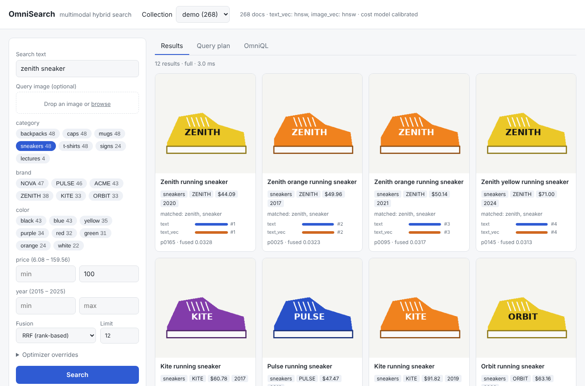
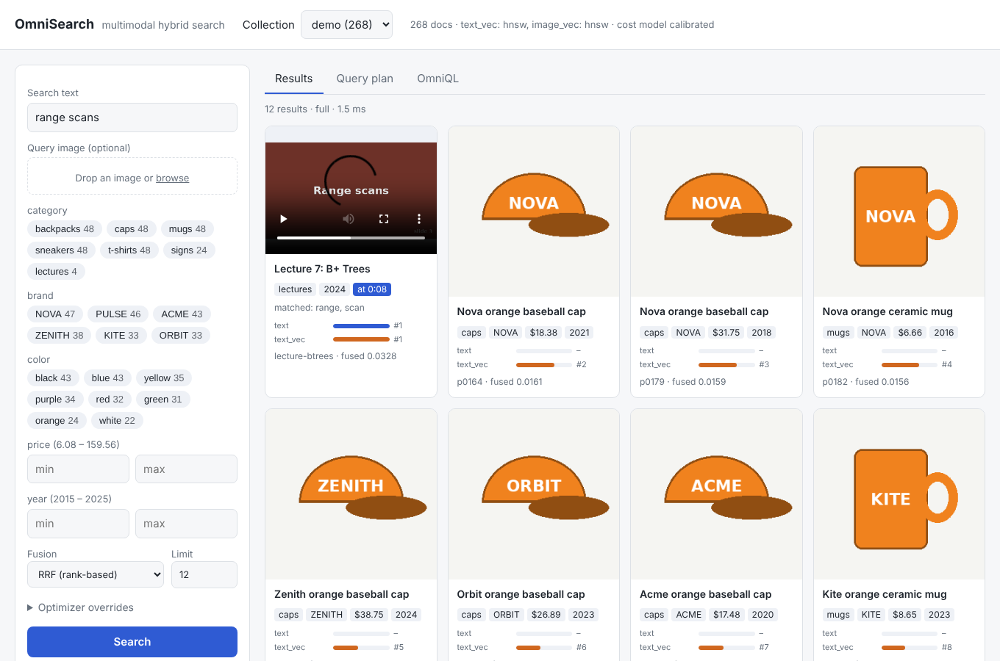
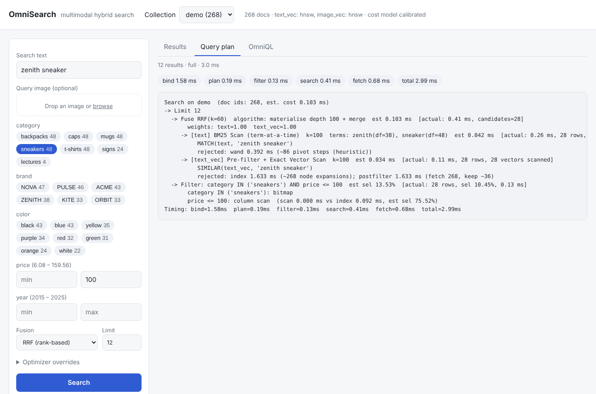

# OmniSearch

**A cost-based multimodal hybrid search engine** - keyword (BM25) + vector
search over text, images, audio and video, with structured filters, a small
query language, a cost-based optimizer and instance-optimal top-k fusion.
Built as an Advanced Database Systems project: the interesting parts are the
*database* parts - index structures, access-path selection, selectivity
estimation and top-k query processing - all implemented from scratch in
Python + numpy and benchmarked against FAISS and SQLite FTS5.

```sql
EXPLAIN ANALYZE
SEARCH products
WHERE MATCH(text, 'zenith sneaker')                         -- BM25 over title + OCR + captions
  AND SIMILAR(image_vec, IMAGE('query.jpg') + 0.5*'in blue') -- composed image + text query
  AND price < 100 AND category IN ('sneakers', 'boots')      -- filters (bitmaps, B+-tree)
FUSE RRF(k=60)
LIMIT 10
```

```
Search on demo  (doc ids: 268, est. cost 0.207 ms)
-> Limit 12
  -> Fuse RRF(k=60)  algorithm: materialise depth 100 + merge  est 0.207 ms  [actual: 0.47 ms, candidates=28]
     -> [text] BM25 Scan (term-at-a-time)  k=100  terms: zenith(df=38), sneaker(df=48)  est 0.142 ms  [actual: 0.24 ms, ...]
          rejected: wand 0.417 ms (~86 pivot steps (heuristic))
     -> [text_vec] Pre-filter + Exact Vector Scan  k=100  est 0.034 ms  [actual: 0.15 ms, 28 rows, 28 vectors scanned]
          rejected: index 1.633 ms (~268 node expansions); postfilter 1.633 ms (fetch 268, keep ~36)
  -> Filter: category IN ('sneakers') AND price <= 100  est sel 13.53%  [actual: 28 rows, sel 10.45%, 0.13 ms]
       category IN ('sneakers'): bitmap
       price <= 100: column scan  (scan 0.000 ms vs index 0.094 ms, est sel 75.52%)
```

---

## What is implemented

| Area | Implementation | Where |
|---|---|---|
| Record store | SQLite (dense internal doc ids, external ids, payload), content-addressed media store | `omnisearch/storage/` |
| Keyword index | Inverted index, gap + variable-byte compressed postings (vectorised codec), BM25, WAND, random-access scoring, `CONTAINS` filters via posting-list intersection, custom binary file format | `omnisearch/index/text/` |
| Vector indexes | HNSW (from scratch, heuristic neighbour selection, in-graph filtering), IVF (own k-means++), exact scan | `omnisearch/index/vector/` |
| Vector compression | Scalar int8 (SQ8), product quantization (PQ, ADC lookup tables) with exact re-ranking | `index/vector/quantize.py` |
| Multi-vector | One vector per video keyframe, MaxSim scoring, best-moment timestamps | `index/vector/multivector.py` |
| Attribute indexes | Bitmap index (category / tags), B+-tree (insert + bulk load, linked leaves), dense columns | `omnisearch/index/attribute/` |
| Statistics | Equi-depth histograms + most-common values + null fraction, auto re-analyze | `index/attribute/histogram.py` |
| Query language | OmniQL lexer + recursive-descent parser, planner with semantic checks | `omnisearch/query/{lexer,parser,planner}.py` |
| Filters | Three-valued (SQL NULL) logic, per-predicate seq-scan vs B+-tree choice | `query/filters.py` |
| Optimizer | Cost model with machine-calibrated unit costs; chooses pre-filter / in-graph / post-filter vector plans, BM25 vs WAND, and the top-k algorithm | `query/{cost,optimizer}.py` |
| Top-k | Fagin's Threshold Algorithm and NRA over sorted + random access sources | `query/topk.py` |
| Fusion | RRF, weighted (max / min-max normalisation), query-adaptive AUTO | `query/fusion.py` |
| EXPLAIN | Plan tree with estimated vs actual rows, costs, rejected alternatives | `query/explain.py` |
| Multimodal ingest | Captions (BLIP), OCR (RapidOCR), speech (Whisper), CLIP / SigLIP, CLAP, ffmpeg keyframes; precomputed values are reused | `omnisearch/encoders/`, `ingest/pipeline.py` |
| API + UI | FastAPI; web UI with text + image query, facet filters, score breakdown, video moments, plan viewer, OmniQL console | `omnisearch/api/` |
| Evaluation | Recall@K / MRR / nDCG for keyword vs vector vs hybrid on COCO, Flickr30k, MSR-VTT, Clotho | `omnisearch/evaluation.py`, `benchmarks/` |
| Baselines | FAISS (HNSW, IVF, IVF-PQ), SQLite FTS5, PostgreSQL + pgvector (docker) | `benchmarks/`, `baselines/pgvector/` |

## Quick start (offline - no model downloads)

```bash
python3 -m venv .venv && source .venv/bin/activate
pip install -r requirements.txt && pip install -e .

pytest -q                               # 100 tests
python -m omnisearch.cli demo           # synthetic multimodal demo collection (~40 s)
python -m omnisearch.cli serve          # http://127.0.0.1:8000
```

The demo generates product photos (with brand names printed on them), street
signs and short lecture videos, then ingests them with real OCR (the
PP-OCR models ship inside the `rapidocr-onnxruntime` wheel), character
n-gram text vectors and colour-layout image vectors. Try:

```bash
python -m omnisearch.cli query "SEARCH demo WHERE MATCH(text, 'no parking') LIMIT 3"     # text read from images
python -m omnisearch.cli query "SEARCH demo WHERE MATCH(text, 'range scans') LIMIT 3"    # returns a video + timestamp
python -m omnisearch.cli query "SEARCH demo WHERE MATCH(text, 'sneakr') AND SIMILAR(text_vec, 'sneakr') LIMIT 3"  # typo: only the vector side finds it
python -m omnisearch.cli explain "SEARCH demo WHERE SIMILAR(image_vec, DOC('p0003')) AND price < 50 LIMIT 5" --analyze
```

In the UI: type a query, drop an image to search by example, toggle facet
chips, then open **Query plan** to see what the optimizer chose, or edit the
generated query in **OmniQL**.

| Results with per-source score bars | Video hit with the matching moment | Physical plan (EXPLAIN ANALYZE) |
|---|---|---|
|  |  |  |

### With neural models (cross-modal search)

```bash
pip install -r requirements-models.txt        # torch, open_clip, transformers, whisper
python -m omnisearch.cli demo --profile clip  # CLIP images/keyframes, BLIP captions, Whisper
```

With CLIP, text queries match images directly (`SIMILAR(image_vec, 'red sneaker')`).
Weights download from huggingface.co on first use; ingest large datasets on a
GPU, or run `scripts/precompute.py` on Colab and ingest the resulting records
anywhere (the pipeline reuses precomputed captions, transcripts and vectors).

## OmniQL

```
[EXPLAIN [ANALYZE]] SEARCH <collection>
  [WHERE <condition>]
  [FUSE RRF(k=60) | WEIGHTED(norm='max'|'minmax'|'none') | AUTO]
  [LIMIT n]
  [WITH (option=value, ...)]
```

| Clause | Meaning |
|---|---|
| `MATCH(field, 'text' [, weight=w])` | BM25 scoring clause on a text field |
| `SIMILAR(field, q [, weight=w, ef=…, nprobe=…])` | vector scoring clause; `q` is `'text'`, `IMAGE('path')`, `AUDIO('path')`, `DOC('id')`, `VECTOR[...]`, or a weighted sum like `0.7*IMAGE('a.jpg') + 0.3*'blue' - 'red'` |
| `CONTAINS(field, 'words')` | hard keyword filter (all terms present) |
| `a = v`, `!=`, `<`, `<=`, `>`, `>=`, `IN (...)`, `BETWEEN x AND y`, `IS [NOT] NULL` | attribute filters, combined with `AND` / `OR` / `NOT` (SQL three-valued logic) |

Scoring clauses must be top-level `AND` terms; a document qualifies if it
passes every filter and appears in at least one scoring clause's results.

`WITH` options override the optimizer for experiments:
`strategy` (`exact` | `index` | `postfilter`), `topk` (`full` | `ta` | `nra` | `exhaustive`),
`keyword_algo` (`exhaustive` | `wand`), `filter_access` (`scan` | `index`), `ef`, `nprobe`,
`depth`, `overfetch`.

## Architecture

```
 INGEST                                      STORAGE                        QUERY
 image ─► OCR, caption, CLIP ──────┐    ┌─ docs.sqlite (records)      ┐   lexer → parser → planner
 audio ─► Whisper, CLAP ───────────┼──► ├─ text/*.osx (inverted idx) ├◄─ bind (analyze terms, encode vectors)
 video ─► keyframes (ffmpeg),      │    ├─ vectors/*.npz (+HNSW/IVF) │   cost-based optimizer
          OCR per frame, Whisper,  │    ├─ multivectors/*.npz        │   filter (bitmaps / B+-tree / scan)
          CLIP per frame ──────────┤    ├─ attrs/*.npz (+stats)      │   branches (BM25 / ANN / MaxSim)
 text ─► analyzer, embeddings ─────┘    └─ media/ (content-addressed)┘   top-k (TA / NRA / merge) → fuse → fetch
```

```
omnisearch/
├── omnisearch/               the engine (Python package)
│   ├── engine.py             Collection / Engine: ingest, delete, query, save/load, calibrate
│   ├── schema.py             data model: media, text, vector, multi-vector, attribute fields
│   ├── storage/              SQLite record store, media store
│   ├── index/text/           analyzer, compressed postings, inverted index (BM25, WAND)
│   ├── index/vector/         store, flat, HNSW, IVF, SQ8/PQ, multi-vector, per-field access paths
│   ├── index/attribute/      bitmap index, B+-tree, histograms
│   ├── encoders/             CLIP, BLIP, RapidOCR, Whisper, CLAP, classic offline encoders, ffmpeg
│   ├── ingest/pipeline.py    modality routing, extraction, batched embedding
│   ├── query/                lexer, parser, planner, filters, cost, optimizer, topk, fusion, executor, explain
│   ├── api/                  FastAPI server, form→OmniQL builder, static web UI
│   ├── datasets/             COCO / Flickr30k / MSR-VTT / Clotho / ABO loaders, synthetic generators
│   ├── evaluation.py         Recall@K, MRR, nDCG; keyword vs vector vs hybrid runner
│   ├── demo.py, cli.py
├── benchmarks/               one script per experiment + plots.py + run_all.py
├── baselines/pgvector/       docker-compose, schema, hybrid RRF query in SQL, runner
├── scripts/                  demo data generator, dataset instructions, GPU precompute
├── tests/                    pytest suite
├── results/                  benchmark JSON, figures, SUMMARY.md
└── docs/report-outline.md    suggested structure for the course report
```

## How the optimizer decides

For each `SIMILAR` clause with a filter of estimated selectivity *s* over *N*
vectors of dimension *d*, the cost model compares:

| Plan | Estimated cost |
|---|---|
| Pre-filter + exact scan | `sN · d · c_gather` |
| HNSW, filter pushed into the graph | `E(ef) / s · c_expand` - the beam must expand ~1/s more nodes to collect `ef` allowed ones |
| HNSW + post-filter | `E(max(ef, 1.5k/s)) · c_expand` - over-fetch so ~1.5k results survive |
| IVF with masked candidates | `nlist·d·c_scan + (nprobe'/nlist)·N·s·d·c_gather`, `nprobe'` widened so ~4k allowed candidates are expected |

`E(ef) = a·ef + b·log2 N` node expansions, with `a`, `b` and every unit cost
fitted on the current machine by `Collection.calibrate()` (stored in
`cost.json`). Selectivity comes from bitmap counts (categories) and equi-depth
histograms + MCVs (numbers), combined under independence. The same model
picks B+-tree vs column scan per range predicate, BM25 vs WAND, and
materialise-and-merge vs Threshold Algorithm vs NRA for score-based fusion.

## Experiments

```bash
python -m benchmarks.run_all          # all systems benchmarks + figures (~20 min, 4 cores)
python -m benchmarks.run_all --quick  # ~2 min
```

Results land in `results/*.json`, figures in `results/figures/`, and tables in
**[results/SUMMARY.md](results/SUMMARY.md)**. These use synthetic data with
controlled structure (clustered vectors, topic-correlated text, attributes with
exact selectivities), which is what systems experiments need; they need no
models or downloads.

| Benchmark | Question |
|---|---|
| `bench_ann` | Recall@10 vs latency for our HNSW / IVF / IVF-PQ vs FAISS |
| `bench_optimizer` | Latency and recall of each filtered access path vs filter selectivity, and the optimizer's choice; correlated vs anti-correlated filters |
| `bench_topk` | Threshold Algorithm / NRA vs materialise-and-merge vs exhaustive: time, accesses, exactness |
| `bench_text` | Posting compression, BM25 exhaustive vs WAND, SQLite FTS5 baseline |
| `bench_filters` | B+-tree vs column scan crossover; histogram q-error (equi-depth + MCV vs equi-width) |
| `bench_quantization` | Memory vs recall for float32 / SQ8 / PQ32 / PQ16 / PQ8 ± re-ranking |
| `bench_scale` | Build time, disk size and query latency from 10k to 50k documents |
| `retrieval_quality` | **Real data**: keyword vs vector vs hybrid on Flickr30k / COCO / MSR-VTT / Clotho |
| `baselines/pgvector/run_pgvector.py` | The same hybrid queries on PostgreSQL + pgvector |

### Headline results (this repo's run: 4-core cloud VM, Python 3.13, single-threaded queries)

Full tables and figures: [results/SUMMARY.md](results/SUMMARY.md).

- **The optimizer tracks the best access path.** On 20,000 vectors with a 0.1%
  filter, the exact pre-filtered scan takes 0.16 ms while HNSW with in-graph
  filtering takes 87.5 ms and HNSW + post-filter 86.7 ms; the optimizer picks
  the exact scan up to 30% selectivity and switches to HNSW for unfiltered
  queries (0.88 ms vs 1.16 ms), with recall 1.00 at every point.
- **Filter correlation matters as much as selectivity.** At the same
  selectivity, HNSW in-graph filtering costs 1.3 ms when the filter is
  correlated with the query's neighbourhood and 29 ms when anti-correlated;
  post-filtering's recall drops from 1.00 to 0.82.
- **Threshold Algorithm is exact and early-stopping.** With two correlated
  lists TA returns the exact top-1 in 0.32 ms vs 3.89 ms for scoring every
  document (12x). Fixed-depth (100) materialise-and-merge is fast but
  returns only 69% of the true top-50 with three independent lists.
- **Keyword index.** Postings compress to 20.5 bits each (3.1x smaller than
  raw); our BM25 top-10 agrees 98% with SQLite FTS5. WAND fully scores 26x fewer
  documents (289 vs 7,600) yet is slower in Python (1.12 vs 0.16 ms p50) -
  its savings are in work, not interpreter time.
- **Range filters.** The B+-tree beats a vectorised column scan below ~0.5%
  selectivity, and the optimizer switches there. Equi-depth histograms + MCVs
  estimate range selectivities with median q-error 1.001 (max 3.2) vs 1.15
  (max 802) for an equi-width histogram on skewed data.
- **Python vs C++.** Our HNSW reaches recall 0.99 at 0.42 ms/query vs 0.033 ms
  for FAISS (~13x); IVF is within ~2.5x. At 20k vectors, a vectorised exact
  scan (0.15 ms) still beats our HNSW - the calibrated cost model knows this.
- **Compression.** SQ8 cuts memory 4x at recall 0.986 (1.000 with
  re-ranking). PQ is weak on these isotropic synthetic vectors (PQ32 + re-rank:
  0.905) - expect better on real CLIP embeddings.
- **Scale.** 50,000 documents: HNSW build 67.5 s (FAISS 3.5 s), 53 MB on disk,
  hybrid query p50 1.24 ms, hybrid + filter 2.40 ms.

### Retrieval quality on real datasets

```bash
python scripts/download_data.py flickr30k     # where to get the files
python -m benchmarks.retrieval_quality --dataset flickr30k --root data/flickr30k
```

This builds a collection whose keyword side indexes BLIP captions + OCR and
whose vector side is CLIP, then scores every caption query in five modes
(`keyword`, `vector`, `hybrid-rrf`, `hybrid-weighted`, `hybrid-auto`). Use
Flickr30k for headline numbers: BLIP-base was fine-tuned on COCO captions, so
COCO keyword/hybrid results are optimistic.

## Limitations

- **Speed.** Everything is Python + numpy; per-query HNSW latency is roughly
  10x FAISS at equal recall, and WAND / NRA, which are inherently sequential,
  lose to vectorised exhaustive scoring despite doing far less work. The
  benchmarks report work done (postings, node expansions, accesses) as well as
  time, so the algorithmic comparison stays meaningful.
- **Durability.** Single writer. The record store commits per insert; index
  files are checkpointed by `save()` (no write-ahead log for indexes).
- **Deletes** are tombstones; there is no compaction.
- **Filtered HNSW** degrades for filters anti-correlated with the query - the
  optimizer avoids it by cost, but ACORN-style neighbour expansion would fix
  the index itself.
- Systems benchmarks use synthetic data; retrieval quality needs the real
  datasets and models.

## References

See [docs/report-outline.md](docs/report-outline.md) for the paper list (BM25,
WAND, HNSW, PQ, Fagin's TA/NRA, RRF, Milvus, AnalyticDB-V, ACORN, CLIP,
System R access-path selection) and a suggested report structure.
