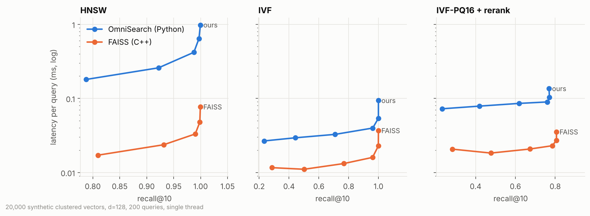
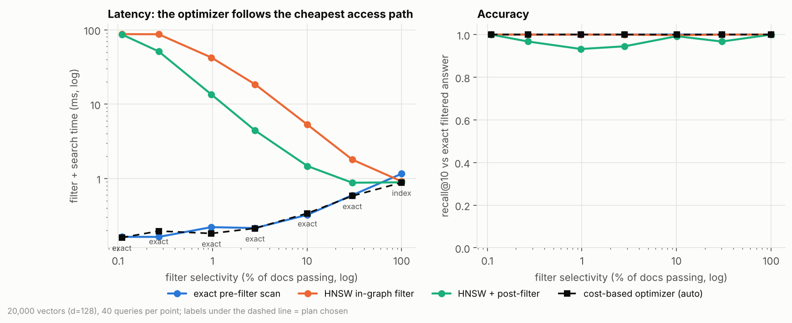
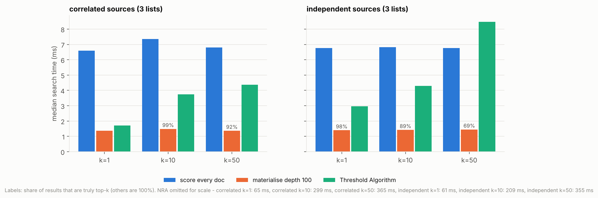
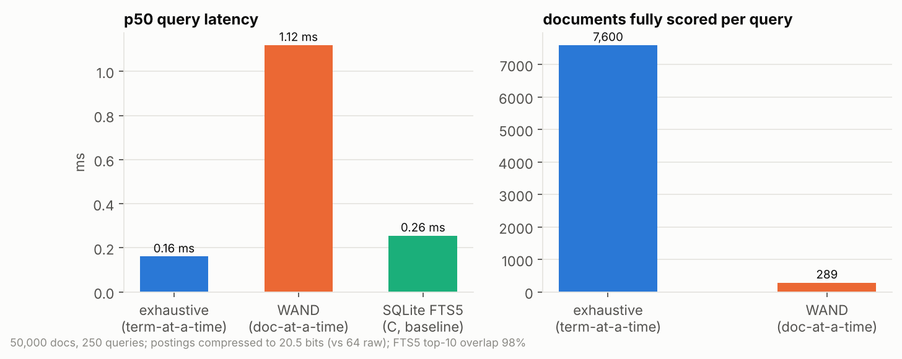
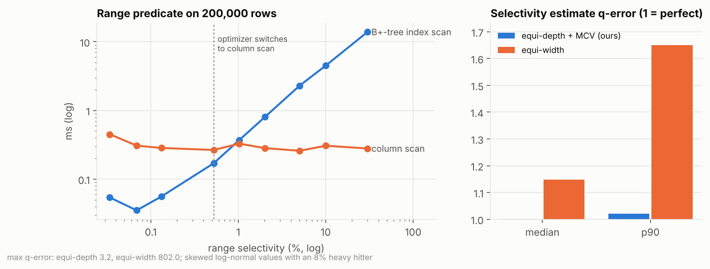
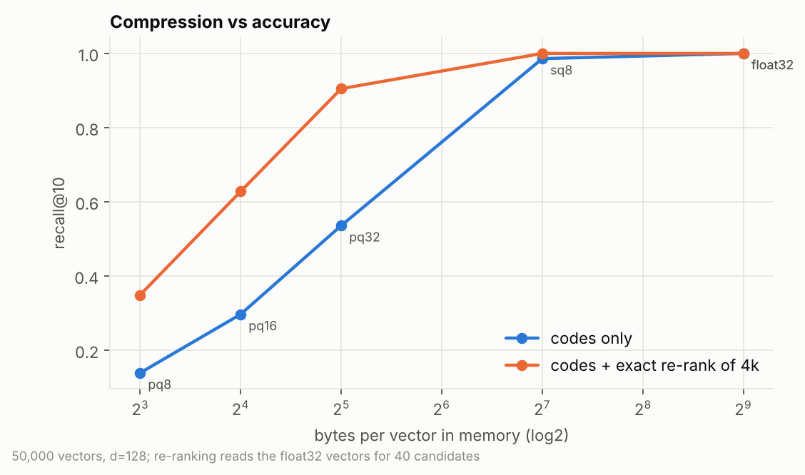
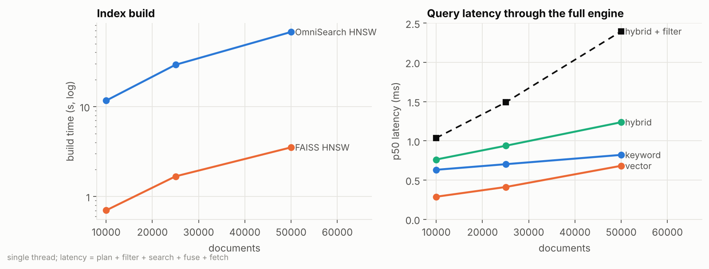

# Benchmark results

Generated by `python -m benchmarks.plots` from `results/*.json`. All systems benchmarks use
synthetic data with controlled structure (no model downloads); retrieval-quality results on real
datasets are produced separately by `benchmarks/retrieval_quality.py`.

## ANN indexes (recall@10 vs latency)

| index | build (s) | best recall | latency at recall >= 0.95 (ms) |
|---|---:|---:|---:|
| hnsw | 22.30 | 1.000 | 0.419 |
| ivf | 2.51 | 1.000 | 0.040 |
| ivf-pq16 | 7.46 | 0.771 | - |
| flat | 0.01 | 1.000 | 0.147 |
| faiss-hnsw | 1.38 | 1.000 | 0.033 |
| faiss-ivf | 0.82 | 1.000 | 0.016 |
| faiss-ivfpq | 1.69 | 0.807 | - |

## Cost-based optimizer vs fixed access paths

| selectivity | exact ms | in-graph ms | post-filter ms (recall) | auto ms (recall) | auto chose |
|---:|---:|---:|---:|---:|---|
| 0.11% | 0.16 | 87.53 | 86.71 (1.00) | 0.16 (1.00) | exact |
| 0.27% | 0.16 | 87.16 | 51.21 (0.97) | 0.20 (1.00) | exact |
| 0.97% | 0.22 | 42.37 | 13.48 (0.93) | 0.18 (1.00) | exact |
| 2.82% | 0.22 | 18.47 | 4.42 (0.95) | 0.21 (1.00) | exact |
| 10.08% | 0.32 | 5.30 | 1.47 (0.99) | 0.34 (1.00) | exact |
| 30.09% | 0.60 | 1.79 | 0.88 (0.97) | 0.58 (1.00) | exact |
| 100.00% | 1.16 | 0.91 | 0.89 (1.00) | 0.88 (1.00) | index |

Filter correlated with the query vs anti-correlated (same selectivity):

| filter | exact ms (recall) | index ms (recall) | postfilter ms (recall) | auto ms (recall) |
|---|---:|---:|---:|---:|
| correlated | 0.16 (1.00) | 1.26 (1.00) | 8.21 (1.00) | 0.15 (1.00) |
| anti-correlated | 0.16 (1.00) | 29.12 (1.00) | 8.82 (0.82) | 0.20 (1.00) |

## Top-k fusion algorithms (WEIGHTED fusion)

| setting | lists | k | exhaustive ms | full ms (correct) | TA ms (correct) | TA sorted+random accesses | NRA ms (correct) |
|---|---:|---:|---:|---:|---:|---:|---:|
| correlated | 2 | 1 | 3.89 | 0.73 (100%) | 0.32 (100%) | 19+18 | 1.09 (100%) |
| correlated | 2 | 10 | 3.81 | 0.72 (100%) | 0.60 (100%) | 59+57 | 2.91 (100%) |
| correlated | 2 | 50 | 3.86 | 0.74 (100%) | 1.23 (100%) | 190+170 | 6.65 (100%) |
| correlated | 3 | 1 | 6.60 | 1.36 (100%) | 1.71 (100%) | 159+302 | 65.23 (100%) |
| correlated | 3 | 10 | 7.34 | 1.49 (99%) | 3.73 (100%) | 405+733 | 299.33 (100%) |
| correlated | 3 | 50 | 6.79 | 1.37 (92%) | 4.37 (100%) | 609+1098 | 365.24 (100%) |
| independent | 2 | 1 | 4.16 | 0.76 (100%) | 0.90 (100%) | 131+131 | 28.03 (100%) |
| independent | 2 | 10 | 3.90 | 0.78 (100%) | 1.71 (100%) | 245+245 | 45.57 (100%) |
| independent | 2 | 50 | 3.94 | 0.78 (99%) | 1.64 (100%) | 274+274 | 51.23 (100%) |
| independent | 3 | 1 | 6.77 | 1.40 (98%) | 2.97 (100%) | 367+729 | 61.02 (100%) |
| independent | 3 | 10 | 6.82 | 1.42 (89%) | 4.29 (100%) | 505+1002 | 209.41 (100%) |
| independent | 3 | 50 | 6.77 | 1.45 (69%) | 8.47 (100%) | 951+1876 | 355.09 (100%) |

## Keyword index

- 50,000 docs, 1,057,314 postings: 2.71 MB compressed vs 8.46 MB raw (20.5 bits per posting)
- vectorised decode: 46 M integers/s
- BM25 p50: exhaustive 0.16 ms, WAND 1.12 ms (scores 289 vs 7600 docs), SQLite FTS5 0.26 ms; top-10 overlap with FTS5 98%

## Attribute filters

| selectivity | B+-tree ms | column scan ms | optimizer |
|---:|---:|---:|---|
| 0.034% | 0.054 | 0.450 | index |
| 0.069% | 0.035 | 0.308 | index |
| 0.132% | 0.056 | 0.284 | index |
| 0.524% | 0.170 | 0.266 | scan |
| 1.025% | 0.370 | 0.329 | scan |
| 2.023% | 0.806 | 0.283 | scan |
| 5.020% | 2.291 | 0.259 | scan |
| 10.018% | 4.504 | 0.306 | scan |
| 30.020% | 13.895 | 0.279 | scan |

Selectivity q-error - equi-depth + MCV: median 1.00, p90 1.02, max 3.2; equi-width: median 1.15, p90 1.65, max 802.0

## Vector compression

| codes | re-rank | bytes/vector | recall@10 | ms |
|---|---:|---:|---:|---:|
| float32 | - | 512 | 1.000 | 0.71 |
| sq8 | - | 128 | 0.986 | 1.77 |
| sq8 | 4 | 128 | 1.000 | 1.85 |
| pq32 | - | 32 | 0.536 | 4.67 |
| pq32 | 4 | 32 | 0.905 | 4.54 |
| pq16 | - | 16 | 0.297 | 2.02 |
| pq16 | 4 | 16 | 0.628 | 1.91 |
| pq8 | - | 8 | 0.139 | 1.06 |
| pq8 | 4 | 8 | 0.349 | 1.07 |

## Scale

| docs | ingest s | HNSW build s | FAISS build s | disk MB | keyword | vector | hybrid | hybrid+filter (p50 ms) |
|---:|---:|---:|---:|---:|---:|---:|---:|---:|
| 10,000 | 0.3 | 11.6 | 0.70 | 10.1 | 0.63 | 0.29 | 0.76 | 1.04 |
| 25,000 | 0.8 | 29.1 | 1.67 | 29.0 | 0.70 | 0.41 | 0.94 | 1.49 |
| 50,000 | 1.7 | 67.5 | 3.52 | 53.3 | 0.82 | 0.68 | 1.24 | 2.40 |

_Environment: Python 3.13.17, numpy 2.5.4, 4 CPUs, 2026-10-23 16:31 UTC._
